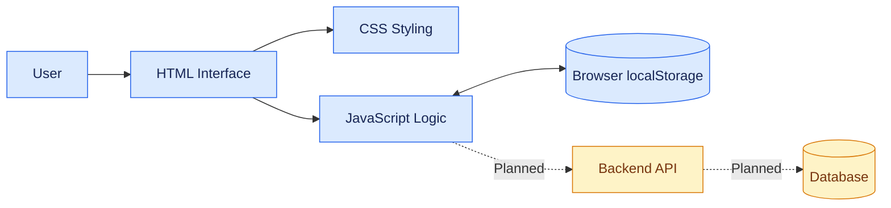

 <div align="center">

# ⚖️ Smart Judicial Management System (SJMS)

### A Web-Based Judicial Case Management Prototype

A centralized interface concept for managing case records, hearing schedules, judgment details, and case-status tracking.


</div>

---

## 📌 About the Project

The **Smart Judicial Management System (SJMS)** is a web-based academic project designed to demonstrate how judicial case information and common case-management activities can be organized through a single interface.

The system prototype provides screens for filing cases, searching case records, viewing hearing schedules, recording judgments, tracking case status, and viewing user records.

The objective is to present a clear, accessible, and organized interface that can serve as a foundation for future judicial management application development.

## 🎯 Objectives

- Organize case-related information in a centralized interface.
- Simplify the process of entering and searching case records.
- Provide an organized view of hearing schedules and judgment details.
- Make case-status information easier to review.
- Develop a responsive and user-friendly web interface.
- Establish a foundation for future backend and database integration.

## ✨ Key Features

| Feature | Description |
|---|---|
| 📊 Dashboard | Displays summary cards and recent sample case information. |
| 📝 File a Case | Provides a form to enter case details. |
| 🔍 Search Cases | Allows users to search and review sample case records. |
| 📅 Hearing Schedule | Displays hearing schedule entries in the prototype. |
| ⚖️ Record Judgment | Provides an interface to enter judgment details. |
| 📍 Track Case Status | Displays the recorded status of a case. |
| 👥 Manage Users | Displays sample user records. |
| 💾 Browser Storage | Uses browser `localStorage` for prototype data. |
| 📱 Responsive Design | Adapts the interface to different screen sizes. |

## 🔄 System Workflow

The following flowchart illustrates the main navigation and intended workflow of the application.


## 🏗️ Application Architecture



**Current architecture:** HTML, CSS, JavaScript, and browser storage.

**Planned architecture:** A backend service and database can be integrated in a future version. The PHP/MySQL backend proposed in the project plan is not connected in the current prototype.

## 👤 Intended User Roles

The project is designed around four intended user roles:

1. **Citizen / Plaintiff** — submit and track case-related information.
2. **Advocate** — review case information and hearing details.
3. **Judge** — review hearing information and record judgment details.
4. **Court Administrator** — manage user-related information.

Role-specific permissions and secure access controls are not implemented in the current prototype.

## 🛠️ Technology Stack

| Technology | Purpose |
|---|---|
| HTML5 | Structure of the web interface |
| CSS3 | Styling and responsive layout |
| JavaScript | Frontend interactions and application logic |
| Browser `localStorage` | Local storage of prototype data |
| PHP | Proposed future backend |
| MySQL | Proposed future database |

## 📂 Project Structure

```text
smart-judicial-management-system/
│
├── index.html
├── style.css
├── script.js
└── README.md
```

- `index.html` — main application interface.
- `style.css` — styles and responsive layout.
- `script.js` — frontend interactions and prototype functionality.
- `README.md` — project documentation.

## 🚀 Installation and Setup

### Prerequisites

- A modern web browser.
- Visual Studio Code (recommended).
- The Live Server extension for VS Code (optional).

### Run the Project Locally

**Step 1:** Clone the repository.

```bash
git clone https://github.com/YOUR-USERNAME/smart-judicial-management-system.git
```

**Step 2:** Open the project folder.

```bash
cd smart-judicial-management-system
```

**Step 3:** Open the folder in Visual Studio Code.

**Step 4:** Open `index.html` in your browser, or right-click it and select **Open with Live Server**.

No Python environment or package installation is required for the current frontend version.

## 🌐 Deployment with GitHub Pages

The current frontend can be hosted using GitHub Pages.

1. Upload the project files to your GitHub repository.
2. Navigate to **Settings → Pages**.
3. Under **Build and deployment**, choose **Deploy from a branch**.
4. Select the `main` branch and `/ (root)` folder.
5. Click **Save**.
6. Wait for GitHub Pages to publish your website.

Your published website URL will appear in the repository's Pages settings.

> GitHub Pages hosts the frontend only. It does not run a PHP backend or provide a database.

## ⚠️ Current Limitations

- The project is currently a frontend prototype.
- Data stored in `localStorage` remains in the current browser.
- Data is not automatically shared between users or devices.
- Secure authentication and role-based authorization are not implemented.
- PHP and MySQL integration is not implemented.
- Real document uploads, server-side storage, and notifications are not implemented.
- Sample records are intended for demonstration only.

## 🔮 Future Enhancements

- [ ] Integrate a backend API.
- [ ] Connect a MySQL database for persistent case records.
- [ ] Implement secure login and role-based access control.
- [ ] Add validated document uploads and secure file storage.
- [ ] Add hearing reminders and notifications.
- [ ] Implement server-side validation and audit logs.
- [ ] Improve accessibility and application security.
- [ ] Add screenshots of the completed interface.

## ⚖️ Disclaimer

This project is developed for academic learning and demonstration. It is not an official court service and should not be used to store real, confidential, or sensitive judicial information.

---

<div align="center">

**Smart Judicial Management System (SJMS)**

*Organizing case information through a digital interface.*

</div>
