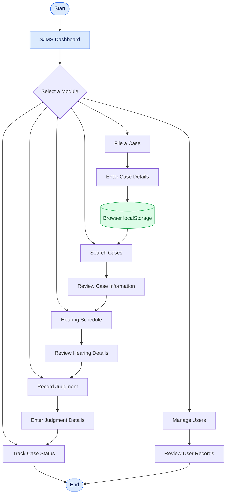
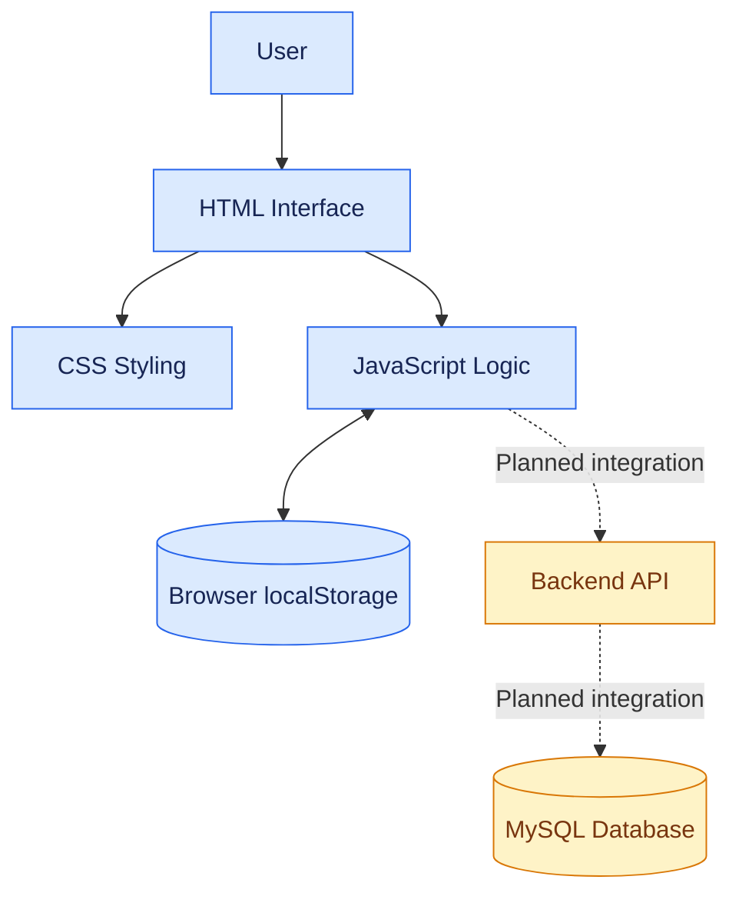

 <div align="center">

# ⚖️ Smart Judicial Management System (SJMS)

### A Web-Based Judicial Case Management Prototype

A centralized interface for case filing, hearing schedules, judgment recording, and case-status tracking.

<p>
  
  
  
  
  
</p>

</div>

---

## 📌 About the Project

The **Smart Judicial Management System (SJMS)** is an academic web-based project designed to demonstrate how judicial case information can be organized through a centralized interface.

The application provides prototype screens for filing cases, searching case records, viewing hearing schedules, recording judgments, tracking case status, and managing user records.

The goal is to demonstrate a user-friendly digital interface that can be extended with backend services and database integration in the future.

## 🎯 Objectives

- Centralize case-related information in one interface.
- Simplify the entry and retrieval of sample case records.
- Organize hearing schedules and judgment information.
- Provide an interface for tracking case status.
- Develop a responsive and user-friendly design.
- Establish a foundation for future backend development.

## 🛠️ Technology Stack

<div align="center">

| Technology | Role in the Project |
|:---:|---|
|  **HTML5** | Structure of the web pages |
|  **CSS3** | Styling and responsive layout |
|  **JavaScript** | Frontend interactions and logic |
| **localStorage** | Stores prototype data in the browser |
| **PHP** | Proposed future backend |
| **MySQL** | Proposed future database |

</div>

> PHP and MySQL are planned technologies and are not connected in the current prototype.

## ✨ Features

| Module | Description |
|---|---|
| 📊 Dashboard | Displays summary cards and recent sample case information. |
| 📝 File a Case | Provides a form to enter case details. |
| 🔍 Search Cases | Allows users to search and review sample case records. |
| 📅 Hearing Schedule | Displays hearing entries in the prototype. |
| ⚖️ Record Judgment | Provides an interface to enter judgment details. |
| 📍 Track Case Status | Displays the recorded status of a case. |
| 👥 Manage Users | Displays sample user records. |
| 📱 Responsive Interface | Adapts the layout to different screen sizes. |

## 🔄 System Workflow

The following flowchart illustrates the main workflow and navigation of the application.



*This flowchart represents the prototype's navigation and intended workflow. It does not represent a fully automated judicial process.*

## 🏗️ Application Architecture



**Current components:** HTML, CSS, JavaScript, and browser localStorage.

**Planned components:** Backend API and database integration.

## 👤 Intended User Roles

The project identifies four intended user roles:

1. **Citizen / Plaintiff** — submit and track case-related information.
2. **Advocate** — review case information and hearing details.
3. **Judge** — review hearing information and enter judgment details.
4. **Court Administrator** — manage user-related information.

Role-specific access permissions and secure authentication are not implemented in the current prototype.

## 📂 Project Structure

```text
smart-judicial-management-system/
│
├── index.html       # Main application interface
├── style.css        # Styling and responsive layout
├── script.js        # Frontend interactions
└── README.md        # Project documentation
```

## 🚀 Installation and Setup

### Prerequisites

- A modern web browser.
- Visual Studio Code (recommended).
- Live Server extension for VS Code (optional).

### Step 1: Clone the Repository

Replace `YOUR-USERNAME` with your GitHub username.

```bash
git clone https://github.com/YOUR-USERNAME/smart-judicial-management-system.git
```

### Step 2: Open the Project

```bash
cd smart-judicial-management-system
```

Open this folder in Visual Studio Code.

### Step 3: Run the Application

Open `index.html` directly in your browser, or right-click the file in VS Code and select **Open with Live Server**.

No Python environment or package installation is required for the current frontend version.

## 🌐 Deployment with GitHub Pages

The current frontend can be published as a static website using GitHub Pages.

1. Upload all project files to your GitHub repository.
2. Open **Settings → Pages**.
3. Under **Build and deployment**, select **Deploy from a branch**.
4. Choose the `main` branch and `/ (root)` folder.
5. Click **Save**.
6. Wait for GitHub Pages to publish the website.

Your website URL will appear in the repository's Pages settings.

> GitHub Pages hosts the frontend only. It does not run a PHP backend or provide a database.

## ⚠️ Current Limitations

- The application is currently a frontend prototype.
- Browser localStorage keeps data in the current browser rather than sharing it between users.
- Clearing browser data may remove locally stored prototype data.
- Secure login and role-based access control are not implemented.
- PHP and MySQL are not connected.
- Real document uploads, server-side storage, notifications, and audit logs are not implemented.
- Sample records are for demonstration purposes only.

## 🔮 Future Enhancements

- [ ] Integrate a backend API.
- [ ] Connect a database for persistent case records.
- [ ] Implement secure authentication and role-based permissions.
- [ ] Add validated document uploads and secure file storage.
- [ ] Implement hearing notifications and reminders.
- [ ] Add server-side validation and audit logs.
- [ ] Improve accessibility and security.
- [ ] Add screenshots of the actual application interface.

## ⚖️ Disclaimer

This project is developed for academic learning and demonstration. It is not an official court service and must not be used to store real, confidential, or sensitive judicial information.

---

<div align="center">

**Smart Judicial Management System (SJMS)**

*Organizing case information through a digital interface.*

</div>
