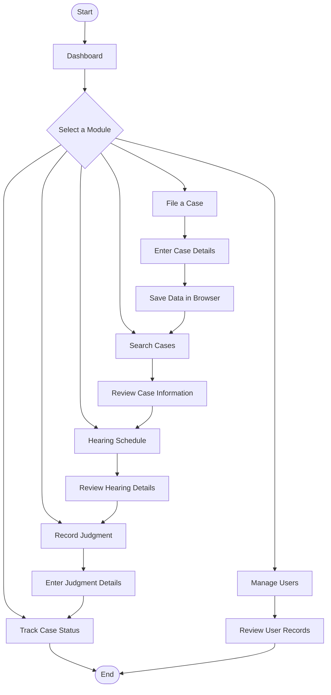
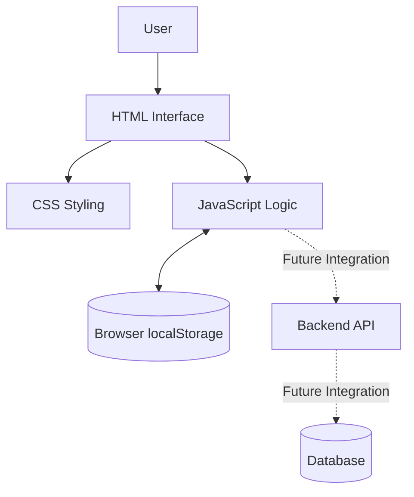

# Smart Judicial Management System (SJMS)

**A Web-Based Judicial Case Management Prototype**

The Smart Judicial Management System (SJMS) is an academic project designed to organize judicial case information through a centralized web interface. It provides prototype screens for case filing, case searching, hearing schedules, judgment recording, case-status tracking, and user management.

## Table of Contents

- About the Project
- Objectives
- Features
- System Workflow
- Application Architecture
- Intended User Roles
- Technology Stack
- Project Structure
- Installation and Setup
- Deployment
- Current Limitations
- Future Enhancements
- Disclaimer

## About the Project

Managing judicial case information involves organizing case records, hearing details, judgments, and status updates. SJMS demonstrates how these activities could be presented in one web application.

The current version is a frontend prototype built with HTML, CSS, and JavaScript. It is intended for academic learning and demonstration, with scope for future backend and database integration.

## Objectives

- Organize case-related information in a centralized interface.
- Provide forms for entering case details.
- Make sample case records easier to search and review.
- Display hearing schedules and judgment information.
- Provide an interface for tracking case status.
- Develop a responsive and user-friendly design.
- Establish a foundation for future backend integration.

## Features

| Module | Description |
|---|---|
| Dashboard | Displays summary cards and recent sample case information. |
| File a Case | Provides a form for entering case details. |
| Search Cases | Helps users search and review sample case records. |
| Hearing Schedule | Displays hearing entries in the prototype. |
| Record Judgment | Provides an interface for entering judgment details. |
| Track Case Status | Displays the recorded status of a case. |
| Manage Users | Displays sample user records. |
| Browser Storage | Uses browser localStorage to store prototype data. |
| Responsive Interface | Adapts the layout to different screen sizes. |

## System Workflow

The following flowchart illustrates the main navigation and intended workflow of SJMS.



*Note: This diagram represents the prototype's navigation and intended workflow, not a fully automated judicial process.*

## Application Architecture

The architecture below distinguishes the currently implemented frontend from possible future backend components.



**Current implementation:** HTML, CSS, JavaScript, and browser localStorage.

**Proposed future implementation:** A backend API and database. PHP and MySQL were proposed in the project plan but are not connected in the current prototype.

## Intended User Roles

The system is designed around four intended user roles:

1. **Citizen / Plaintiff:** Submit and track case-related information.
2. **Advocate:** Review case information and hearing details.
3. **Judge:** Review hearing information and enter judgment details.
4. **Court Administrator:** Manage user-related information.

Role-specific permissions and secure access controls are not implemented in the current version.

## Technology Stack

| Technology | Purpose |
|---|---|
| HTML5 | Structure of the web interface |
| CSS3 | Styling and responsive layout |
| JavaScript | Frontend interactions and application logic |
| Browser localStorage | Local storage of prototype data |
| PHP | Proposed future backend |
| MySQL | Proposed future database |

## Project Structure

```text
smart-judicial-management-system/
│
├── index.html
├── style.css
├── script.js
└── README.md
```

- `index.html` — main application interface.
- `style.css` — styling and responsive layout.
- `script.js` — frontend interactions and prototype functionality.
- `README.md` — project documentation.

## Installation and Setup

### Prerequisites

- A modern web browser.
- Visual Studio Code (recommended).
- Live Server extension for VS Code (optional).

### Steps to Run the Project

**Step 1: Clone the repository**

Replace `YOUR-USERNAME` with your GitHub username.

```bash
git clone https://github.com/YOUR-USERNAME/smart-judicial-management-system.git
```

**Step 2: Open the project folder**

```bash
cd smart-judicial-management-system
```

**Step 3:** Open the folder in Visual Studio Code.

**Step 4:** Open `index.html` directly in a browser, or right-click it in VS Code and select **Open with Live Server**.

The current frontend does not require Python, a package installation, or a build command.

## Deployment

### Deploy using GitHub Pages

The current HTML, CSS, and JavaScript frontend can be published using GitHub Pages.

1. Upload the project files to your GitHub repository.
2. Open **Settings → Pages**.
3. Under the build and deployment section, select **Deploy from a branch**.
4. Choose the `main` branch and the `/ (root)` folder.
5. Click **Save**.
6. Wait for GitHub Pages to publish the website.

Your published website URL will appear in the repository's Pages settings.

**Important:** GitHub Pages hosts the frontend only. It does not run a PHP backend or provide a database.

## Current Limitations

- This project is currently a frontend prototype.
- Browser localStorage keeps data in the current browser and does not automatically share it across users or devices.
- Clearing browser data may remove locally stored prototype data.
- Secure authentication and role-based authorization are not implemented.
- PHP and MySQL integration is not implemented.
- Real document uploads, secure server-side storage, notifications, and audit logs are not implemented.
- Sample records are for demonstration purposes only.

## Future Enhancements

- [ ] Integrate a backend API.
- [ ] Connect a MySQL database for persistent case records.
- [ ] Implement secure authentication and role-based access control.
- [ ] Add validated document uploads and secure file storage.
- [ ] Add hearing notifications and reminders.
- [ ] Implement server-side validation and audit logs.
- [ ] Improve accessibility and security.
- [ ] Add screenshots of the completed application.

## Disclaimer

This project is developed for academic learning and demonstration. It is not an official court service and must not be used to store real, confidential, or sensitive judicial information.

---

**Project:** Smart Judicial Management System (SJMS)  
**Project Type:** Web-Based Frontend Prototype  
**Current Technologies:** HTML, CSS, JavaScript

*Organizing case information through a digital interface.*
